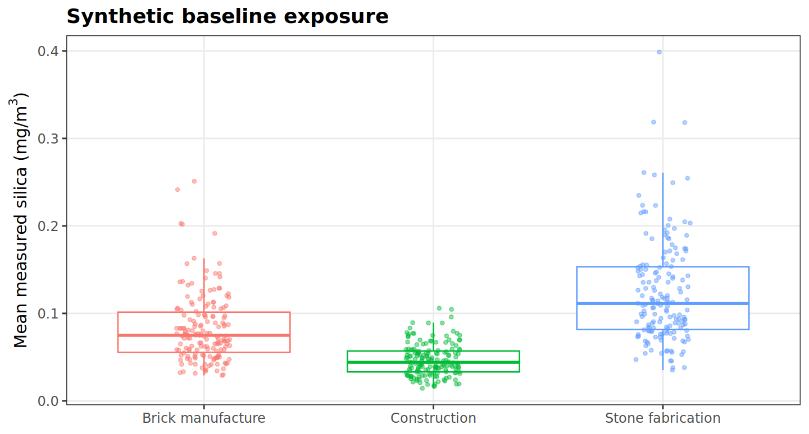
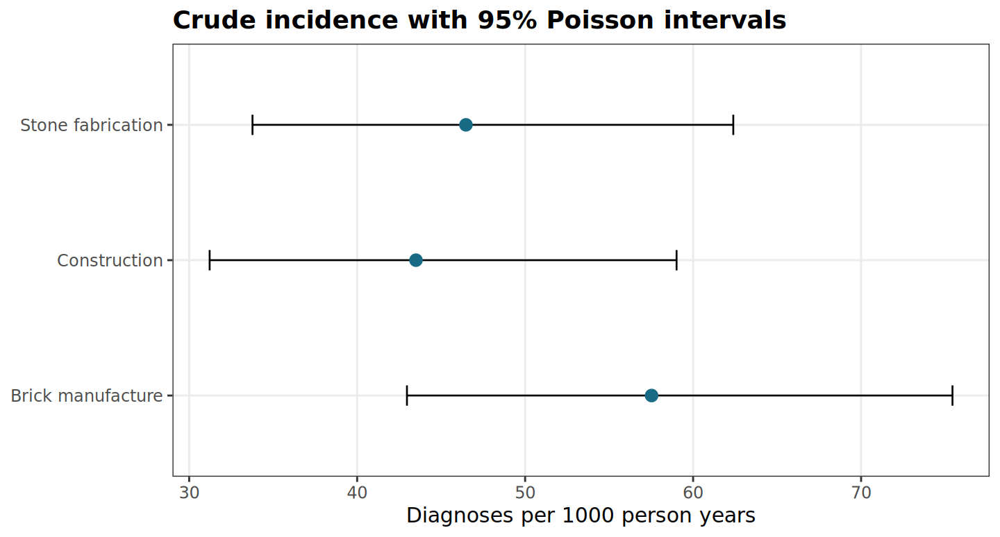
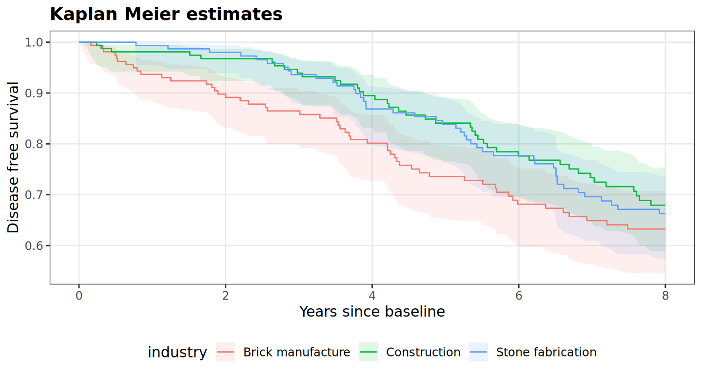
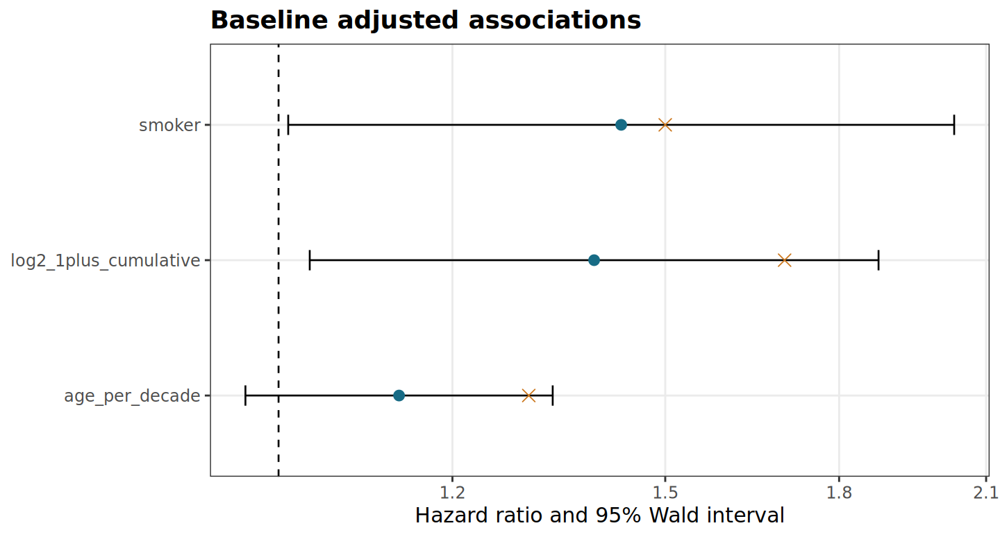
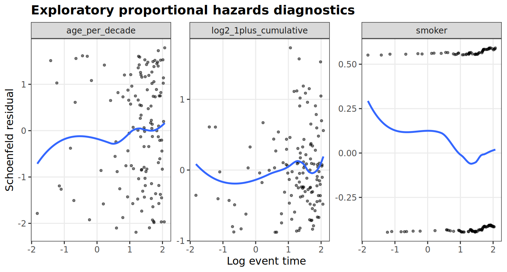
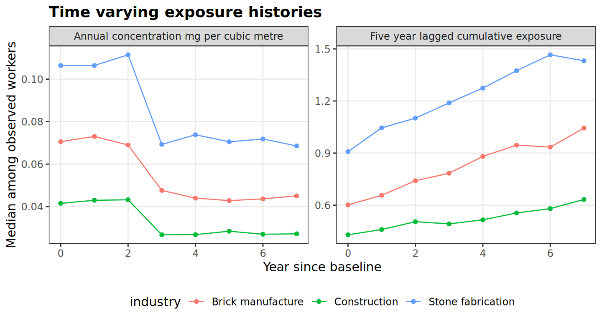
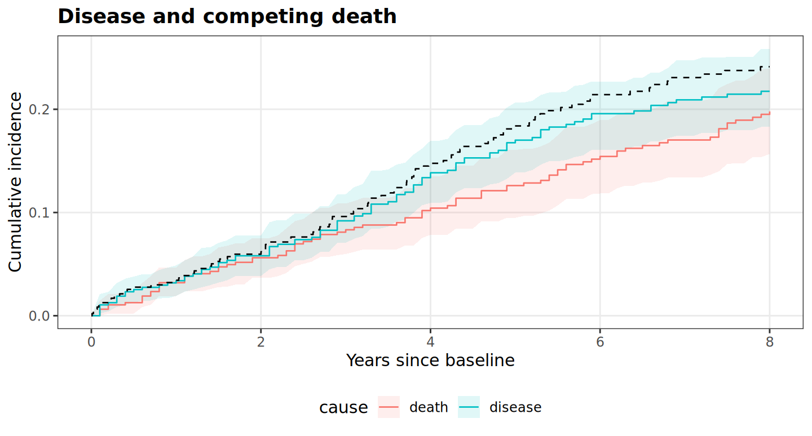
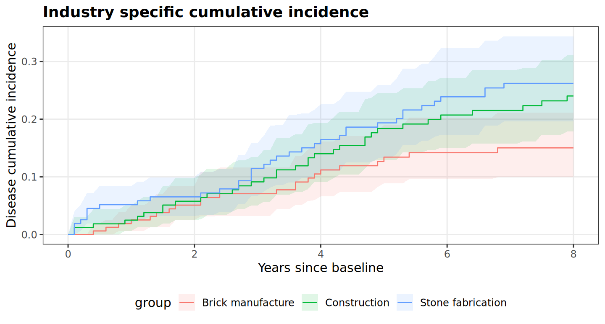
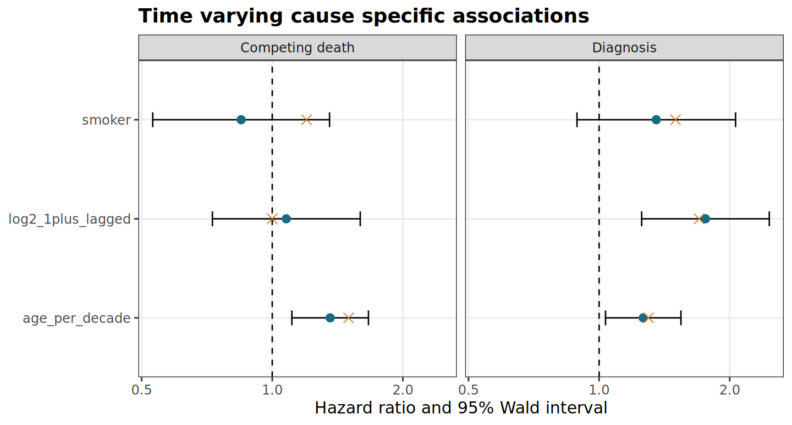
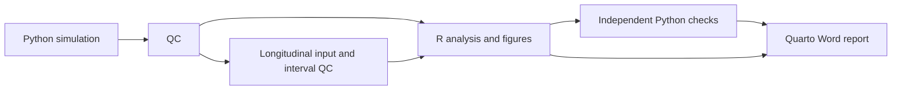

# Occupational exposure and respiratory disease surveillance in a simulated cohort

**OccuSurv-NF: a reproducible R and Nextflow analysis with Quarto reporting**

> **Simulation study.** Every worker, measurement, diagnosis and death in this repository is synthetic. The results describe one deliberately constructed data-generating mechanism. They are not estimates of occupational disease burden in South Africa, do not use NIOH records and imply no institutional endorsement.

## Abstract

**Background:** Occupational surveillance requires consistent handling of exposure histories, prevalent disease, follow-up time and competing events. A reproducible analysis must connect these quantities to clearly defined statistical estimands and an auditable reporting process.

**Methods:** We generated 500 workers across three industries and twelve workplaces, with historical exposure, repeated baseline measurements and selected data defects. A baseline scenario evaluated prevalence, incidence and disease-free survival. A separate longitudinal scenario introduced annually varying exposure and competing death. Analyses used R for descriptive estimation, Kaplan–Meier curves, baseline and time-varying cause-specific Cox regression, and Aalen–Johansen cumulative incidence. Nextflow coordinated execution; Python independently recomputed numerical results; Quarto generated the Word report.

**Results:** QC retained 499 workers. The baseline incident cohort contributed 137 diagnoses over 2,793.1 person-years, giving 49.05 diagnoses per 1,000 person-years. The longitudinal scenario included 477 workers, 93 diagnoses and 83 deaths. Eight-year cumulative incidence was 0.217 for diagnosis and 0.198 for competing death. The time-varying exposure association with diagnosis was HR 1.759 (95% CI 1.253–2.468). All 23 full-data numerical comparisons and 19 applicable small-data comparisons passed.

**Conclusion:** The workflow produced internally consistent estimates and reproducible reports under its stated simulation assumptions. Agreement between implementations supports computational correctness for the tested examples; it does not establish real-world validity, causal effects, statistical power or confidence-interval coverage.

## Introduction

Occupational respiratory disease surveillance combines information measured on different timescales. Recent concentration measurements describe the monitoring period, whereas disease development may depend on historical exposure accumulated over many years. Prevalent disease must be distinguished from incident diagnoses, and workers contribute different amounts of observation time. Death can prevent a subsequent diagnosis, making the distinction between a cause-specific hazard and an absolute probability of disease particularly important.

This study evaluates an analysis workflow in which those distinctions are explicit. Synthetic data permit known exposure effects, controlled censoring and deliberate data-quality defects, allowing the computational implementation to be examined without accessing identifiable worker records. The aim is to establish a transparent chain from source tables and QC decisions to statistical estimates, figures and a reproducible research report.

Two scenarios are analysed. The first provides a baseline reference using fixed historical exposure. The second generates independent follow-up outcomes on the eligible disease-free workers and introduces time-varying exposure and competing mortality. It is a separate simulation scenario, not an extension of the original outcomes or a paired comparison of exposure interventions.

## Methods

### Study population and data generation

The baseline sample comprised 500 simulated workers allocated to construction, brick manufacture and stone fabrication across twelve workplaces. Age was generated uniformly between 25 and 65 years. Employment duration was the smaller of a Uniform(3,30) draw and age minus 18. Smoking was Bernoulli with probability 0.35. Historical concentration was lognormal, with industry medians of 0.04, 0.07 and 0.12 mg/m³, workplace log-scale SD 0.18 and worker log-scale SD 0.35. Each worker had three baseline measurements with multiplicative lognormal measurement error of SD 0.25.

Workplace variation affected exposure but did not introduce unmeasured shared disease frailty. This assumption permits model-based inference conditional on the included covariates; it is not an assertion that real workers within a workplace are independent. The baseline and longitudinal generators used seeds 2026 and 2027. All effect sizes and event-rate parameters were assumed for this simulation rather than calibrated to empirical silicosis data.

### Quality control and analysis populations

Raw records were preserved. Exact duplicate worker records were collapsed; conflicting identifiers failed validation. QC checked required fields, identifier relationships, age and employment chronology, concentration units and nonnegative values, valid disease indicators, and follow-up within the eight-year observation window. Injected defects included an ineligible age, a duplicate row, negative follow-up, invalid measurements and missing smoking.

Prevalence used all eligible workers. Incident analyses excluded baseline disease and invalid follow-up. Missing smoking was retained in descriptive summaries but excluded from regression. In the longitudinal scenario, intervals were required to be positive, contiguous and nonoverlapping, with a single terminal event or censoring time and no observation after an event. Exposure covariates had to agree with the historical schedule at interval entry. [QC provenance](results/clean/qc.json) and the [row-level audit](results/clean/audit.csv) retain the decisions; audit reasons can overlap and are not counts of unique excluded workers.

### Exposure definition and baseline outcome model

For historical concentration $c_i$, employment duration $d_i$ and a five-year lag, cumulative exposure and its dimensionless transformation were

$$
C_i=c_i\max(d_i-5,0),\qquad x_i=\log_2(1+C_i/C_0),\qquad C_0=1\ \mathrm{mg\,year/m^3}.
$$

With $a_i=(\mathrm{age}_i-45)/10$ and smoking indicator $s_i$, the baseline generating model was

$$
h_i(t)=1.4(0.012)t^{0.4}\exp(\eta_i),\qquad
\eta_i=\log(1.7)x_i+\log(1.3)a_i+\log(1.5)s_i.
$$

Event times were obtained by inverse transformation:

$$
T_i=\left[\frac{-\log U_i}{0.012\exp(\eta_i)}\right]^{1/1.4},\qquad U_i\sim\mathrm{Uniform}(0,1).
$$

Observed time was the minimum of diagnosis time and independent censoring, with censoring itself the minimum of eight years and an exponential draw of mean 25 years. Baseline disease probability was generated using $\operatorname{expit}(-3.4+0.5x_i+0.3a_i)$. Prevalent cases did not enter incident follow-up.

### Descriptive estimation and baseline survival analysis

For $k$ baseline cases among $n$ workers, prevalence was $\widehat p=k/n$, with Wilson 95% limits

$$
\frac{\widehat p+z^2/(2n)\ \pm\ z\sqrt{\widehat p(1-\widehat p)/n+z^2/(4n^2)}}{1+z^2/n},\qquad z=\Phi^{-1}(0.975).
$$

Incidence was $1000D/PY$, where $D$ is the diagnosis count and $PY$ the observed person-years. Exact Poisson bounds were

$$
\frac{1000}{2PY}\left[\chi^2_{2D,0.025},\ \chi^2_{2(D+1),0.975}\right],
$$

with lower bound zero when $D=0$. Kaplan–Meier survival used

$$
\widehat S(t)=\prod_{t_j\le t}\left(1-\frac{d_j}{n_j}\right),\qquad
G(t)=\sum_{t_j\le t}\frac{d_j}{n_j(n_j-d_j)}.
$$

Here $n_j$ is the risk set and $d_j$ the diagnosis count at time $t_j$. Pointwise log-log intervals used Greenwood quantity $G(t)$ and the exact normal critical value. Bounds at survival zero or one were set explicitly to that boundary value.

Cox regression included transformed exposure, age per decade and smoking. For cause $k$, the Breslow log partial likelihood was

$$
\ell_k(\beta)=\sum_j\left[\sum_{i\in D_{jk}}X_i(t_j)^T\beta-d_{jk}\log\left\{\sum_{i\in R(t_j)}\exp[X_i(t_j)^T\beta]\right\}\right].
$$

The baseline analysis used diagnosis as the sole event. Newton optimisation used the score $U$ and observed information $I$:

$$
\beta^{(m+1)}=\beta^{(m)}+I(\beta^{(m)})^{-1}U(\beta^{(m)}),\qquad
\widehat V=I(\widehat\beta)^{-1}.
$$

Hazard ratios and Wald intervals were $\exp(\widehat\beta)$ and $\exp(\widehat\beta\pm z\sqrt{\widehat V_{kk}})$. Fits required finite coefficients and standard errors and maximum absolute score below $10^{-4}$. Each model required at least 30 complete-case events; this is a computational safeguard, not a sample-size or power calculation. P values are exploratory and unadjusted.

Schoenfeld residuals were examined against log event time, with descriptive LOESS smoothing and rank correlations. R's `cox.zph` supplied a separate log-time scaled Schoenfeld score test. A non-significant test was not interpreted as proof of proportional hazards.

### Time-varying exposure and competing-risk analysis

At annual boundary $u$, the longitudinal exposure metric incorporated historical concentration and past annual concentrations $e_{im}$:

$$
C_i(u)=c_i\max\{d_i-\max(5-u,0),0\}+\sum_{m=0}^{u-6}e_{im}.
$$

The sum is empty when its upper limit is negative. Annual concentrations followed the historical concentration with lognormal variability of SD 0.25 and a factor of 0.65 from year three. The predictor $\log_2[1+C_i(u)/C_0]$ was held constant within each annual interval. Risk sets followed $(\mathrm{start},\mathrm{stop}]$, so at most one interval per worker contributed at each event time. Full planned schedules were stored as latent inputs, but post-event values entered neither risk sets nor observed exposure plots.

Diagnosis and death had piecewise-constant baseline hazards of 0.018 and 0.025 per year. Their assumed exposure, age and smoking hazard ratios were $(1.7,1.3,1.5)$ and $(1.0,1.5,1.2)$ respectively. Waiting times were exponential with rate $h_1+h_2$; event cause was drawn with probability $h_k/(h_1+h_2)$. Follow-up ended at first diagnosis, death or independent censoring. Separate cause-specific Cox models used the interval data, with the alternative cause censored at its occurrence.

Absolute diagnosis and death probabilities were estimated by Aalen–Johansen:

$$
\widehat F_k(t)=\sum_{t_j\le t}\widehat S(t_j-)\frac{d_{jk}}{n_j},\qquad
\widehat S(t)=\prod_{t_j\le t}\left(1-\frac{d_{j1}+d_{j2}}{n_j}\right).
$$

Pointwise 95% percentile intervals used 200 whole-worker bootstrap samples within each displayed group, with R seed 2028. These are neither simultaneous bands nor workplace-cluster-robust intervals. Cause-specific hazard ratios describe instantaneous rates among event-free workers; they are not cumulative-incidence risk ratios or Fine–Gray subdistribution hazard ratios. No Fine–Gray model was fitted.

### Software and numerical validation

R `survival` implemented Cox models, Kaplan–Meier estimation, Aalen–Johansen estimation and proportional-hazards tests; `ggplot2` generated all nine report figures. Nextflow coordinated simulation, QC, R analysis, Python cross-checking and Quarto Word rendering. Python remained the synthetic-data generator and an independent numerical reference, rather than the production statistical implementation.

The implementations used identical records, covariates, Breslow ties and model-skip rules. Deterministic comparisons required absolute differences below $10^{-7}$. Aalen–Johansen, shared-index bootstrap and harmonised Kaplan–Meier interval checks used $10^{-12}$. For KM bounds, Python independently recomputed the exact normal quantile used by R; its historical rounded-1.96 bounds remain archived. Saved R bootstrap indices allowed Python to recompute exactly the same samples. The workflow stops if a comparison fails. Further specifications are provided in [the mathematical methods](docs/METHODS.md).

## Results

### Cohort retention and descriptive characteristics

QC retained 499 workers, with mean age 46.3 years (SD 11.6). Smoking was observed for 484 workers, including 176 smokers; 15 values were missing. Twenty-two workers had baseline disease, giving prevalence 4.41% (Wilson 95% CI 2.93–6.58%). After excluding prevalent disease and invalid follow-up, 476 workers entered the baseline incident analysis. Its complete-case Cox model included 461 workers and 130 diagnoses.

| Measure | Baseline scenario | Longitudinal scenario |
|---|---:|---:|
| Workers contributing follow-up | 476 | 477 |
| Diagnoses | 137 | 93 |
| Competing deaths | Not generated | 83 |
| Person-years | 2,793.1 | 2,603.4 |
| Complete-case regression workers | 461 | 462 |
| Complete-case diagnosis events | 130 | 89 |
| Complete-case death events | Not applicable | 80 |

The longitudinal scenario includes one additional worker because follow-up is newly generated for all eligible baseline disease-free workers, including a worker with invalid original follow-up. Event counts from the two scenarios should not be combined or interpreted as an intervention contrast.

### Exposure distributions and crude incidence

Measured concentrations were highest in stone fabrication and lowest in construction, reflecting the specified exposure distributions. Within-industry variation arose from workplace and worker effects plus measurement error. These recent measurements support descriptive monitoring summaries; the fitted outcome models instead use the known simulated historical exposure.



*Figure 1. Worker means of valid baseline concentration measurements, with industry distributions.*

The baseline cohort experienced 137 diagnoses over 2,793.1 person-years: 49.05 per 1,000 person-years (95% CI 41.18–57.98). Brick manufacture had the highest realised crude rate, despite stone fabrication having higher measured exposure. This illustrates why a crude industry comparison cannot be interpreted as an adjusted exposure effect in one small sample; the group-specific intervals were wide and overlapped.

| Industry | Diagnoses | Person-years | Rate per 1,000 person-years | 95% CI |
|---|---:|---:|---:|---:|
| Brick manufacture | 52 | 903.9 | 57.53 | 42.96–75.44 |
| Construction | 41 | 942.5 | 43.50 | 31.22–59.02 |
| Stone fabrication | 44 | 946.7 | 46.48 | 33.77–62.39 |



*Figure 2. Industry-specific incidence with exact Poisson 95% intervals.*

### Baseline survival and adjusted associations

The unadjusted survival curves declined across all industries. Their separation describes this realised sample, without adjustment for covariate distributions. At eight years, 76 workers in brick manufacture, 72 in construction and 79 in stone fabrication remained at risk immediately before administrative censoring. The declining risk sets constrain interpretation of later follow-up.



*Figure 3. Kaplan–Meier estimates with pointwise log-log 95% intervals. The Word report includes the time-specific risk table.*

Higher transformed historical exposure was associated with diagnosis in the baseline simulation (HR 1.392, 95% CI 1.033–1.876). The realised estimate was below the assumed HR of 1.7, which remained within its interval. Smoking had HR 1.432 (1.010–2.031); the age estimate was imprecise. These are associations in generated data, not estimates of effects in a real workforce. The exposure contrast is a one-unit increase in $\log_2(1+C/C_0)$, not a doubling of raw concentration.

| Covariate | HR | 95% CI | P value | Assumed HR |
|---|---:|---:|---:|---:|
| Transformed historical exposure | 1.392 | 1.033–1.876 | 0.0296 | 1.70 |
| Age per decade | 1.135 | 0.966–1.333 | 0.1242 | 1.30 |
| Smoker versus nonsmoker | 1.432 | 1.010–2.031 | 0.0437 | 1.50 |



*Figure 4. Adjusted hazard ratios with Wald 95% intervals; orange crosses identify generating effects.*

Residual trajectories varied over log time, but the formal log-time proportional-hazards test did not detect a departure in this sample (global chi-square 1.894, 3 df, P=0.595). This result does not establish that proportional hazards holds or that the sample had adequate sensitivity to detect violations. The smooth lines are exploratory rather than fitted time-varying effects.



*Figure 5. Schoenfeld residuals with LOESS curves. [Term-specific score tests](results/analysis/cox_zph.csv) are available separately.*

### Longitudinal exposure and cumulative incidence

Annual concentrations declined after the planned year-three reduction, while lagged cumulative exposure continued to rise as earlier exposure entered the eligible history. The five-year lag means that the concentration reduction has little or no influence on hazards within the eight-year observation window. The plot therefore must not be read as evidence of preventive efficacy. Later medians describe workers still observed and can also change as the risk set changes.



*Figure 6. Industry medians of annual concentration and lagged cumulative exposure among observed workers.*

The separate longitudinal scenario produced 93 diagnoses and 83 deaths among 477 workers. Eight-year Aalen–Johansen diagnosis probability was 0.217, while competing-death probability was 0.198. Treating deaths as ordinary censoring in one minus Kaplan–Meier yielded a higher diagnosis curve because it estimates a different quantity; it does not estimate observed disease probability in the presence of competing death.

| Eight-year outcome | Cumulative incidence | Pointwise bootstrap 95% CI |
|---|---:|---:|
| Diagnosis | 0.217 | 0.183–0.259 |
| Competing death | 0.198 | 0.157–0.240 |



*Figure 7. Aalen–Johansen estimates and percentile bootstrap intervals. The dashed curve is one minus Kaplan–Meier with death censored.*

Industry-specific diagnosis probabilities differed descriptively, with substantial uncertainty. These curves reflect both diagnosis and competing-death processes and are not adjusted industry contrasts. Their overlap and the limited number of outcomes do not support a ranking of real occupational risks.



*Figure 8. Unadjusted diagnosis cumulative incidence with pointwise bootstrap intervals.*

### Time-varying cause-specific associations

The time-varying exposure association with diagnosis was HR 1.759 (95% CI 1.253–2.468), close to the assumed value 1.7 in this realisation. The exposure association with competing death was HR 1.078 (0.728–1.595), compatible with the generating value 1.0. Age was positively associated with both event rates. Smoking estimates were imprecise; the death estimate below one should not be interpreted as protection, particularly because its generating effect was above one and its interval was wide.

| Endpoint | Covariate | HR | 95% CI | P value | Assumed HR |
|---|---|---:|---:|---:|---:|
| Diagnosis | Time-varying exposure transform | 1.759 | 1.253–2.468 | 0.0011 | 1.70 |
| Diagnosis | Age per decade | 1.264 | 1.035–1.544 | 0.0218 | 1.30 |
| Diagnosis | Smoker versus nonsmoker | 1.354 | 0.889–2.063 | 0.1576 | 1.50 |
| Death | Time-varying exposure transform | 1.078 | 0.728–1.595 | 0.7091 | 1.00 |
| Death | Age per decade | 1.360 | 1.110–1.666 | 0.0030 | 1.50 |
| Death | Smoker versus nonsmoker | 0.848 | 0.530–1.355 | 0.4905 | 1.20 |



*Figure 9. Cause-specific hazard ratios and model-based Wald intervals, with generating values shown as crosses.*

### Computational validation

All 23 full-data comparisons passed. Baseline and cause-specific Cox estimates agreed between R and Python to within approximately $5\times10^{-13}$. Aalen–Johansen estimates agreed within $5.4\times10^{-15}$, and shared-sample bootstrap bounds within $5.3\times10^{-16}$. The largest difference across all checks was $1.82\times10^{-12}$, in the descriptive incidence table. The [comparison table](results/crosscheck/comparison.csv) records each tolerance and observed difference.

The 40-worker smoke test passed 19 applicable comparisons. Baseline and both cause-specific regressions were skipped because their complete-case event counts were below 30. All 26 existing Python tests and the R checks for hand-calculated cumulative incidence, probability conservation, all-censored observations and interval-boundary risk sets passed. Cached execution was also tested. These checks establish agreement for the tested examples, not broad statistical operating characteristics.

## Discussion

The analysis demonstrates the importance of separating exposure measurement, historical exposure reconstruction, event rates and cumulative probabilities. Recent concentration summaries and crude industry incidence did not follow identical rankings in the realised sample. The adjusted regression and descriptive industry summaries answer different questions and should not be substituted for one another.

The competing-risk scenario also shows why an exposure hazard ratio is insufficient to describe absolute disease probability. Diagnosis cumulative incidence depends on both the diagnosis hazard and survival free of competing death. The separation between Aalen–Johansen and one minus Kaplan–Meier is therefore a consequence of their different estimands, rather than a numerical disagreement between methods.

The time-varying implementation preserves temporal ordering through annual covariates and explicit risk intervals. Nevertheless, the planned exposure reduction cannot establish an intervention effect: outcomes were not generated as paired counterfactuals, follow-up was short relative to the lag, and the simulation omitted time-varying confounding. Any causal interpretation would require a different design and estimand.

Several limitations restrict interpretation. This is one small synthetic realisation, so it cannot establish bias, power or nominal interval coverage. Effects, exposure distributions and baseline rates were assumed. Historical exposure was known without reconstruction error; censoring was independent; missingness was generated under simplified assumptions; and unmeasured workplace frailty was absent. The 200-replicate bootstrap has Monte Carlo uncertainty and does not address workplace clustering. Complete-case regression may be unsuitable when missingness depends on unobserved exposure or disease. Healthy-worker selection, diagnostic error and informative loss to follow-up remain outside the current model.

Independent R and Python agreement strengthens confidence in the implemented calculations, but both implementations share the scientific assumptions and estimands. It cannot validate those assumptions for an empirical study. Application to real surveillance data would require approved access, defensible case definitions, exposure-history evaluation, appropriate dependence modelling and external validation.

## Conclusion

OccuSurv-NF integrates QC, baseline survival analysis, time-varying exposure and competing risks within a reproducible Nextflow workflow. R generates the statistical results and figures, Python supplies independent numerical checks, and Quarto produces the Word report with editable equations and tables. The simulated examples passed the stated numerical and execution checks. Their contribution is a transparent, tested analytical implementation; they provide no empirical estimates of occupational disease burden or preventive effectiveness.

## Reproducibility and data availability

All committed observations are synthetic. The [Word research report](results/report/OccuSurv_report.docx), [Quarto source](report/OccuSurv.qmd), [R analysis](bin/analyse.R), [baseline tables](results/analysis/), [longitudinal tables](results/longitudinal/) and [archived Python reference](validation/python-v0.2/) are available in this repository. The [validation record](validation/VALIDATION.md) distinguishes successful checks, resolved development failures and untested deployment paths.

The tested environment was Nextflow 25.10.2, Java 21, R 4.3.3, survival 3.5-8, ggplot2 3.4.4 and Quarto 1.10.19 under Ubuntu 24.04 through WSL. Sources, working files and results reside on Toshiba at `D:/occusurv-nf`; executable runtimes and the R library reside on the Linux filesystem. [R package versions](validation/R-packages.csv), [R session information](results/analysis/R-sessionInfo.txt) and the [Python environment](validation/python-lock.txt) record the executed software.



### Local execution

Install Java, Nextflow, R and Quarto. From a Linux or WSL shell in the repository:

```bash
python3 -m venv ~/.venvs/occusurv-nf
source ~/.venvs/occusurv-nf/bin/activate
pip install -r requirements.txt
export R_LIBS_USER="$HOME/R/occusurv"
mkdir -p "$R_LIBS_USER"
Rscript install.R
nextflow run main.nf --n_workers 500 --seed 2026 --outdir results-reproduction
Rscript tests/test_survival.R
python -m unittest discover -s tests -v
nextflow run main.nf --n_workers 500 --seed 2026 --outdir results-reproduction -resume
nextflow run main.nf -profile smoke --outdir results-smoke-reproduction
```

`install.R` installs CRAN dependencies; it does not enforce historical versions. Use the recorded version inventory when constructing an exact environment. Linux source installation may require development libraries such as `libuv1-dev`. The legacy Python statistical and reporting scripts are retained for audit, but the production graph selects R and Quarto. No LaTeX installation is needed for Word output. The [local workflow text](RUN_WORKFLOW.txt) records the Toshiba configuration.

Use a fresh output directory for each design: Nextflow does not remove stale published files from earlier runs. Keep its work directory and cache for `-resume`. Source scripts are explicit process inputs, so edits invalidate relevant cached tasks. The six processes are SIMULATE, QC, LONGITUDINAL_INPUT, ANALYSE_R, CROSSCHECK and REPORT. Execution traces are distinct from the scientific Word report.

### HPC execution

The small datasets do not require HPC. A Slurm profile is provided but has not been tested on a cluster. On an institution's Linux cluster, use shared paths for the repository, Python, R, Quarto and the R library; replace the account and partition in [the site template](conf/site.config.example). Windows drive paths are not valid on a remote cluster.

```bash
nextflow run main.nf -profile slurm -c conf/site.config --outdir results-cluster -resume
```

No remote cluster jobs were submitted. Local defaults request one CPU and 2 GB per task.

## Methodological and software references

- [R survival reference manual](https://stat.ethz.ch/CRAN/web/packages/survival/refman/survival.html): `coxph`, `survfit` and `cox.zph`.
- [Statsmodels survival analysis](https://www.statsmodels.org/stable/duration.html): independent Python model implementation.
- [Quarto Word output](https://quarto.org/docs/output-formats/ms-word.html): executable research reporting.
- [Nextflow documentation](https://docs.seqera.io/nextflow/): workflow execution, provenance and caching.
