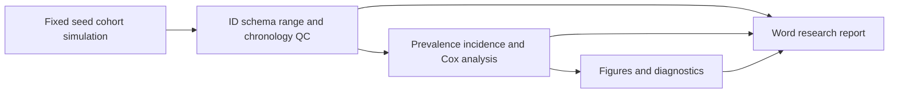
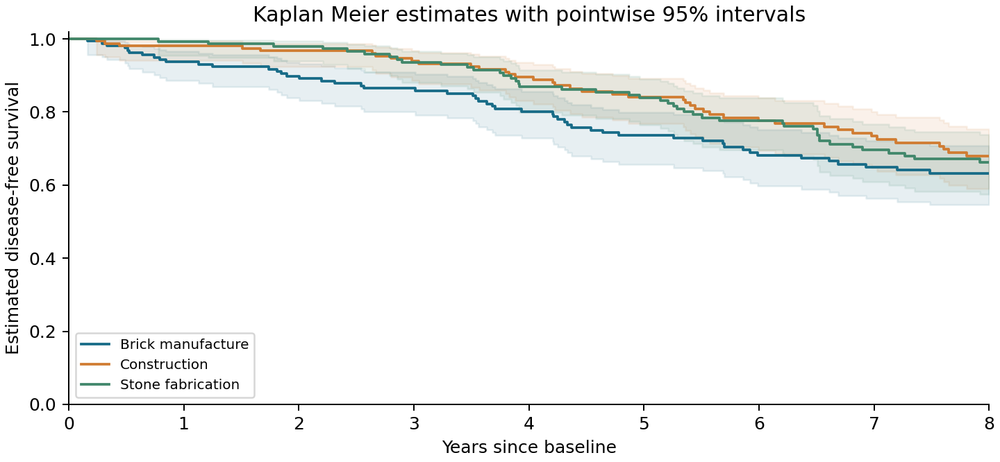
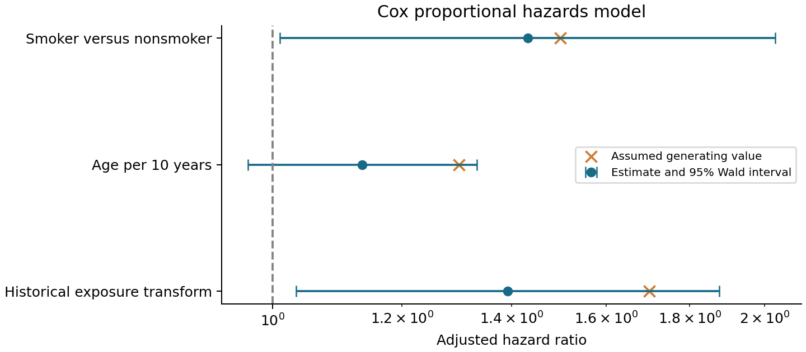

# OccuSurv NF

## Occupational exposure and respiratory disease surveillance

OccuSurv NF is a reproducible Nextflow DSL2 workflow for quality control, exposure assessment, descriptive epidemiology and survival analysis of a synthetic occupational cohort. The present application evaluates a small, deliberately imperfect dataset representing workers in construction, brick manufacture and stone fabrication. It is motivated by occupational respiratory disease surveillance, but uses no NIOH records, claims no institutional endorsement and does not estimate actual South African disease burden.

The study asks whether an explicit data-generating mechanism, auditable exclusions and a reproducible execution graph can support coherent reporting from worker, measurement and follow-up tables. Statistical algorithms and assumptions are specified in [the mathematical methods](docs/METHODS.md); the [Word report](results/report/OccuSurv_report.docx) combines methods, tables, figures and limitations.



## Study design

Five hundred workers are allocated across twelve workplaces and three industries. Each has age, smoking status, a historical employment duration and concentration, three noisy baseline exposure measurements, and baseline disease status. Only workers without baseline disease enter incident follow-up. Follow-up ends at diagnosis, independently generated loss to follow-up, or eight years.

The five-year lagged cumulative exposure is concentration multiplied by eligible historical duration. The regression uses `log2(1 + cumulative exposure / reference unit)`, age per decade and smoking. Workplace effects shift exposure but do not add unmeasured disease frailty, so the regression uses model-based conditional-independence standard errors. The model does not reconstruct lifetime onset or assume that three recent measurements capture lifetime exposure.

This design intentionally produces enough diagnoses to exercise the statistical code. The incidence level and all effect sizes are assumed demonstration parameters, not calibrated silicosis rates. One realised dataset cannot establish power, bias or confidence interval coverage.

## Results

| Measure | Result |
|---|---:|
| Generated workers | 500 |
| Retained eligible workers | 499 |
| Baseline cases | 22 |
| Incident cohort | 476 |
| Incident events | 137 |
| Person years | 2793.1 |
| Rate per 1000 person years | 49.05 (41.18 to 57.98) |
| Complete case model participants | 461 |
| Complete case model events | 130 |

Baseline prevalence was 4.41% (Wilson 95% CI 2.93% to 6.58%).

| Model term | Estimated HR | 95% CI | P value | Assumed HR |
|---|---:|---:|---:|---:|
| log2_1plus_cumulative | 1.392 | 1.033 to 1.876 | 0.0296 | 1.70 |
| age_per_decade | 1.135 | 0.966 to 1.333 | 0.1242 | 1.30 |
| smoker | 1.432 | 1.010 to 2.031 | 0.0437 | 1.50 |

Complete tables: [Cox estimates](results/analysis/cox.csv), [incidence](results/analysis/incidence.csv), [prevalence](results/analysis/prevalence.csv), [Table 1](results/analysis/table1.csv), and [model status and assumptions](results/analysis/analysis.json).


The Cox model uses complete cases, with no automated covariate selection. The minimum absolute-data requirement is 30 events for three coefficients; this is a fail-safe for this demonstration and not a general sample-size rule. The maximum absolute score at the fitted solution is below 1e-4 and no fitting warnings were emitted. P values are exploratory and unadjusted.

### Exposure monitoring


**Figure 1.** Mean of valid baseline measurements for each worker, with industry distributions. Means do not replace the known historical concentrations used in the synthetic hazard. No regulatory exposure threshold is applied.

### Disease occurrence


**Figure 2.** Unadjusted incidence rates per 1,000 person-years with conventional 95% Poisson intervals. These intervals condition on observed person-time and do not account for all possible workplace heterogeneity.



**Figure 3.** Kaplan–Meier estimates among initially disease-free workers. Shading denotes pointwise log-minus-log 95% intervals. Industry differences are descriptive and do not identify a causal industry effect. [Numbers at risk](results/analysis/risk_table.csv) are provided at 0, 2, 4, 6 and 8 years.

### Adjusted associations



**Figure 4.** Estimated hazard ratios and 95% Wald confidence intervals against the assumed generating values. The exposure HR refers to one unit of the transformed cumulative-exposure variable; it is not per doubling of raw cumulative exposure. Finite-sample estimates are allowed to differ from the assumed values.


**Figure 5.** Schoenfeld residuals versus log event time with LOWESS smoothing. This is an exploratory proportional-hazards diagnostic; neither visually flat curves nor small descriptive rank correlations establish proportional hazards. No formal global PH test is claimed.

## Mathematical methods

For worker i, historical exposure is defined using concentration c, employment duration d and a five-year lag:

$$
C_i=c_i\max(d_i-5,0),\qquad x_i=\log_2(1+C_i/C_0),\quad C_0=1\;\mathrm{mg\,year/m^3}.
$$

The synthetic incident hazard is Weibull with covariate multiplier:

$$
h_i(t)=1.4(0.012)t^{0.4}\exp(\eta_i),\qquad
\eta_i=\log(1.7)x_i+\log(1.3)(\mathrm{age}_i-45)/10+\log(1.5)\mathrm{smoker}_i.
$$

Inverse-transform sampling gives event time:

$$
T_i=\left[\frac{-\log U_i}{0.012\exp(\eta_i)}\right]^{1/1.4},\quad U_i\sim\mathrm{Uniform}(0,1).
$$

Observed time is the minimum of event time and independent censoring. Cox regression maximises the partial likelihood over observed diagnoses, using contemporaneous risk sets rather than assigning a distribution to the fitted baseline hazard. Newton updates use the score and observed information; confidence intervals are obtained by exponentiating coefficient Wald intervals. The [full specification](docs/METHODS.md) covers partial likelihood, optimisation, information matrix, Wilson prevalence intervals, person-time rates, Kaplan–Meier and Greenwood calculations, and Schoenfeld residuals. The Word report displays these equations as high-resolution equation images; the LaTeX sources remain editable in `docs/methods.json`.

## Quality control and analysis decisions

| Check | Action and rationale |
|---|---|
| Required columns and identifiers | Missing columns or conflicting duplicate IDs stop the workflow. Exact worker duplicates are collapsed and recorded. |
| Eligibility and historical exposure | Exclude invalid age, employment duration, concentration or baseline status. A 1e-8 tolerance in years accommodates CSV rounding at the employment-age boundary. |
| Measurements | Exclude unmatched worker IDs, negative/nonfinite concentrations, invalid durations and non-mg/m3 units; never guess a conversion. |
| Follow-up | Require unique IDs, positive finite times no greater than eight years, binary event status and baseline disease-free eligibility. |
| Missing smoking | Retain in descriptive statistics; exclude from the regression only. Missingness is generated completely at random here; no imputation is performed. |
| Person-time | Stop follow-up at the observed diagnosis or censoring time. Baseline cases never enter the incidence denominator. |
| Event sufficiency | Skip Cox below 30 complete-case events; do not create placeholder effect estimates. |
| Model convergence | Require finite coefficients/standard errors and maximum absolute score below 1e-4; preserve model status and warnings. |
| Diagnostics | Export event-time Schoenfeld residuals and descriptive rank correlations. Model assumptions are not declared validated by a plot. |

The [row-level audit](results/clean/audit.csv) contains overlapping reasons and warnings: audit entries are not a count of unique excluded workers. Input checksums are stored in [QC provenance](results/clean/qc.json). No source data are overwritten by QC. The generated defects include one duplicate worker row, an ineligible age, a negative follow-up time, two invalid measurements, and missing smoking values.

## Execution and reproducibility

The workflow was tested with Nextflow 25.10.2, Java 21 and Python 3.13 on Ubuntu 24.04 through WSL. Source, task working directories and results reside on Toshiba. The isolated scientific Python environment is on the WSL Linux filesystem because executable installation on the external Windows drive failed. The report process in this tested run uses the bundled Windows Python 3.12 environment with python-docx 1.2.0; this configuration is documented in the validation record. It uses the same report script as the portable Python entry point.

On Linux or WSL, install Java and Nextflow according to the [official installation instructions](https://docs.seqera.io/nextflow/install). Use the recorded Nextflow version for close reproduction. From the repository root:

```bash
python3 -m venv ~/.venvs/occusurv-nf
source ~/.venvs/occusurv-nf/bin/activate
pip install -r requirements.txt
nextflow run main.nf --n_workers 500 --seed 2026 --outdir results-reproduction
python -m unittest discover -s tests -v
nextflow run main.nf --n_workers 500 --seed 2026 --outdir results-reproduction -resume
```

Use Python 3.13 for the tested scientific environment. `validation/python-lock.txt` records the full installed dependency set; `requirements.txt` pins direct dependencies. The repository includes equation images, so Node, LaTeX and equation generation are not required to execute the report process. To regenerate equation assets after editing their LaTeX, run `python bin/equations.py`, which uses Matplotlib's mathtext renderer.

Small-data testing:

```bash
nextflow run main.nf -profile smoke --outdir results-smoke
```

A run with 40 workers exercises the low-event model-skip path while still producing QC, descriptive results, figures and a report. Use a separate output directory for each seed or design to avoid confusing published outputs. Nextflow's work directory and cache must remain available for `-resume`; see [cache and resume](https://docs.seqera.io/nextflow/cache-and-resume).

The main execution graph contains five processes:

| Process | Inputs | Outputs |
|---|---|---|
| SIMULATE | Worker count, seed, generator | `raw/` tables and truth parameters |
| QC | Raw tables | `clean/` tables, exclusion audit and input hashes |
| ANALYSE | Clean tables and truth | Descriptive tables, survival curves, Cox results, diagnostics and versions |
| FIGURES | Analysis outputs | Five PNG figures when regression is fitted; three when skipped |
| REPORT | Analysis, QC, figures and equation assets | Word report and report-runtime versions |

Process scripts are explicit Nextflow inputs so source changes invalidate relevant cache entries. Each run also exports execution trace, timeline and Nextflow HTML report. The scientific Word report is separate from Nextflow's computational HTML report.

## Linux HPC execution

HPC is optional for these small files. The supplied `slurm` profile changes task execution to Slurm; its use has not been tested on a cluster. Copy the repository to cluster storage, activate an environment available on compute nodes, add a site configuration for account/partition, and launch Nextflow according to local policy. Do not use Windows drive paths on a remote cluster.

```bash
nextflow run main.nf -profile slurm -c conf/site.config \
  --outdir results-cluster -resume
```

`conf/site.config.example` is a template, not an active configuration. Replace the queue and account placeholders and give the driver enough time to remain running until its tasks finish. The local defaults request one CPU and 2 GB memory per process. No remote jobs were submitted.

## Validation and limitations

The [validation record](validation/VALIDATION.md) distinguishes executed checks from untested deployment paths. Tests include deterministic data generation, injected defects, ID conflicts, missing schemas, known survival values, interval boundary cases and model skipping. The full run is a computational demonstration, not validation of a clinical risk tool.

Important limitations include absent competing mortality, healthy-worker selection, uncertain historical exposure, informative censoring, time-varying covariates and unmeasured workplace frailty. A real surveillance application requires a prespecified estimand, approved data access, clinically meaningful case definitions, appropriate dependence modelling and external validation. No spatial, Bayesian or causal intervention analysis is implied by this release.

## Sources and implementation

- [Nextflow documentation](https://docs.seqera.io/nextflow/)
- [Statsmodels survival analysis](https://www.statsmodels.org/stable/duration.html)
- [PHReg model and numerical methods](https://www.statsmodels.org/stable/generated/statsmodels.duration.hazard_regression.PHReg.html)
- [PHReg fit options and robust group covariance](https://www.statsmodels.org/stable/generated/statsmodels.duration.hazard_regression.PHReg.fit.html)

The project is prepared for GitHub publication. No GitHub remote is configured for this new project. All committed datasets are synthetic; temporary environments, Nextflow work directories and report-rendering intermediates are excluded from version control.
